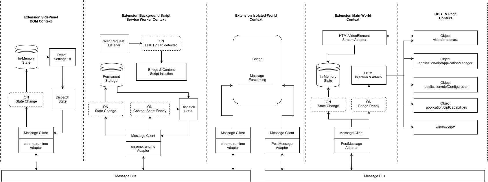

# HbbTV Emulator



> Roadmap, decisioni architetturali e stato del progetto: [ROADMAP.md](./ROADMAP.md).

## Prerequisites

[Bun](https://bun.sh/) (see `packageManager` in `package.json`).

## Setup

```bash
bun install
```

## Development

```bash
bun run build        # build all packages (turbo)
bun run dev          # all packages in watch mode
bun run clean        # remove build artifacts
bun run format       # format (biome)
bun run lint         # lint (biome)
```

### Extensions

```bash
bun run extension:build   # builds extensions/{chrome-v3,chrome-v2,firefox-v2}
```

Load the unpacked extension from `extensions/<target>/dist`.

**chrome-v3**: use Chromium (branded Chrome ignores unpacked extensions loaded from the
command line since v137), then in `chrome://extensions` → HbbTV Emulator → Details turn on
**Allow User Scripts** (Chrome 138+; developer mode on older versions). With it, pages
start with the configured user agent and channels, as on a TV; without it, the
configuration reaches them only after their first scripts have run.

**firefox-v2**: in `about:debugging#/runtime/this-firefox` → *Load Temporary Add-on…*
pick `extensions/firefox-v2/dist/manifest.json` (unsigned add-ons load only as temporary
ones, until Firefox restarts). The toolbar button opens the settings UI in the sidebar.

## Tests

Unit tests use [Vitest](https://vitest.dev/).

```bash
bun run test            # all packages, through turbo (cached)
bun run test:watch      # whole monorepo in watch mode
bun run test:coverage   # coverage report per package (coverage/)
```

Inside a package: `bun run test` / `bun run test:watch`.

End-to-end tests (`e2e/`) load the built extensions in a real browser and run the HbbTV test applications in `e2e/fixtures`, served with the HbbTV content type:

```bash
bun run test:e2e        # builds the extensions first (turbo)
```

They need a Chromium binary (`/usr/bin/chromium` by default, or `HBB_EMU_CHROMIUM=/path/to/chromium`); branded Google Chrome cannot load unpacked extensions from the command line.
The Firefox suite needs a Firefox binary (`/usr/bin/firefox` by default, or `HBB_EMU_FIREFOX=/path/to/firefox`), driven by Puppeteer over WebDriver BiDi.

Conventions:

- tests live next to the code: `foo.ts` → `foo.test.ts`
- each package has a `vitest.config.ts` that extends the root `vitest.shared.ts` (environment `node` or `jsdom`)
- tests are excluded from the build via `tsconfig.build.json`
- dependencies are faked through their ports / Reader environment, never by mocking modules; shared fakes go in `src/__tests__/`
- a known bug can be pinned with `it.fails(...)` and a comment pointing to the roadmap item that fixes it

## Package Management

```bash
bun run syncpack:check   # check version mismatches
bun run syncpack:fix     # fix version mismatches
```

## Packages

**Extensions** (`extensions/`)
- `@hbb-emu/extension-chrome-v3` - Chrome (Manifest V3)
- `@hbb-emu/extension-firefox` - Firefox (Manifest V2)
- `@hbb-emu/extension-chrome-v2` - Chromium legacy (Manifest V2), manifest and background only

**Runtime**
- `@hbb-emu/core` - Shared utilities, DOM helpers, storage, logger
- `@hbb-emu/oipf-api` - OIPF/HbbTV object models, validation, and type definitions
- `@hbb-emu/oipf-runtime` - OIPF APIs implementation and the TV's subsystems
- `@hbb-emu/state` - The emulator's state, shared by every host: channels, AIT, stream events, defaults
- `@hbb-emu/protocol` - Messages between the page runtime and its host
- `@hbb-emu/page-runtime` - The runtime injected in the HbbTV page
- `@hbb-emu/extension-runtime` - Background, bridge, injector and adapters shared by the extensions

**Player System**
- `@hbb-emu/player-runtime` - Core player runtime with state management
- `@hbb-emu/player-adapter-web` - Web adapters (Native, HLS.js, dash.js)
- `@hbb-emu/player-adapter-hbbtv` - HbbTV-specific player adapter (AVControl, MediaElementSource)
- `@hbb-emu/player-ui` - Player debug UI overlay with controls and state visualization

**UI Components**
- `@hbb-emu/settings-ui` - Settings UI for configuring HbbTV environment and channels
